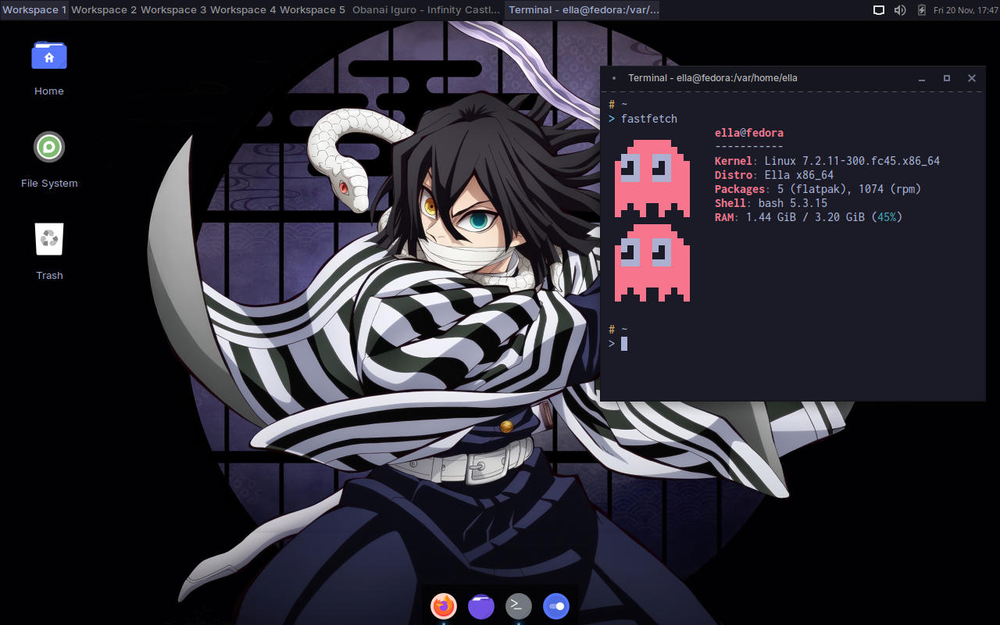

# Ella 

***Ella*** is a minimal Fedora KDE Plasma desktop built with *KIWI NG*.



### Install
Boot the ISO to start a KDE Plasma live desktop; Ella's installer opens in Kitty. It supports UEFI and legacy BIOS; boot the ISO in the firmware mode you want installed. The installer erases the selected disk and installs with LUKS2 + Btrfs. Choose “Exit to live desktop” to close the installer without installing. Installation time depends on the computer and storage; the installer shows phase timings when it finishes. After installation, remove the media and press Enter to reboot.

### Build the ISO
```
sudo ./build.sh                 # in a privileged Fedora 45 container (Podman/Docker)
sudo ./build.sh --native        # directly on a Fedora 45 host
```

### Update & Maintain
`sudo dnf upgrade --refresh && sudo systemctl reboot`

### Installing apps
- Use KDE Discover (Flathub and Fedora packages) or `flatpak` for Flathub apps.
- `dnf install` for Fedora packages.

### Snapshots
On first boot Ella creates a [Snapper](http://snapper.io/) config for `/` and takes a Btrfs snapshot before and after every `dnf` transaction (the last 10 are kept). Your home is not snapshotted.
```
sudo snapper -c root list
sudo snapper -c root status 12..13      # what a transaction changed
sudo snapper -c root undochange 12..13  # undo those file changes
```
This is file-level undo, not a bootable rollback.

### Multimedia codecs
Open *Install Multimedia Codecs* from the app menu (or run `ella-codecs`). It enables RPM Fusion and swaps `ffmpeg-free` for full `ffmpeg`.

### NVIDIA
Not set up by default. After `ella-codecs`: `sudo dnf install akmod-nvidia`, wait for the module to build, then reboot. With Secure Boot on, enroll a key first (`kmodgenca` + `mokutil --import`) or the module won't load.

### Disk encryption
LUKS2 passphrase at boot. TPM2 auto-unlock is not set up by default.

### Apps Pre-installed 

- firefox
- KDE Plasma
- Dolphin (file manager)
- Kate (text editor)
- Ark (archive manager)
- Spectacle (screenshots)
- Kitty terminal
- Gwenview (image viewer)
- Celluloid (media player)
- GParted and smartmontools
- Gnote
- KDE Discover software center
- neovim
- btop
- fastfetch

### Dev tools Pre-installed
 - gcc
- gcc-c++
- clang 
- clang-tools-extra
- cmake
-  ninja-build
- make 
- gdb 
- lldb 
- valgrind 
- git
- curl
- pkgconf-pkg-config
- openssl-devel 
- python3
- python3-pip 
- python3-devel 

### License
[MIT](LICENSE)
